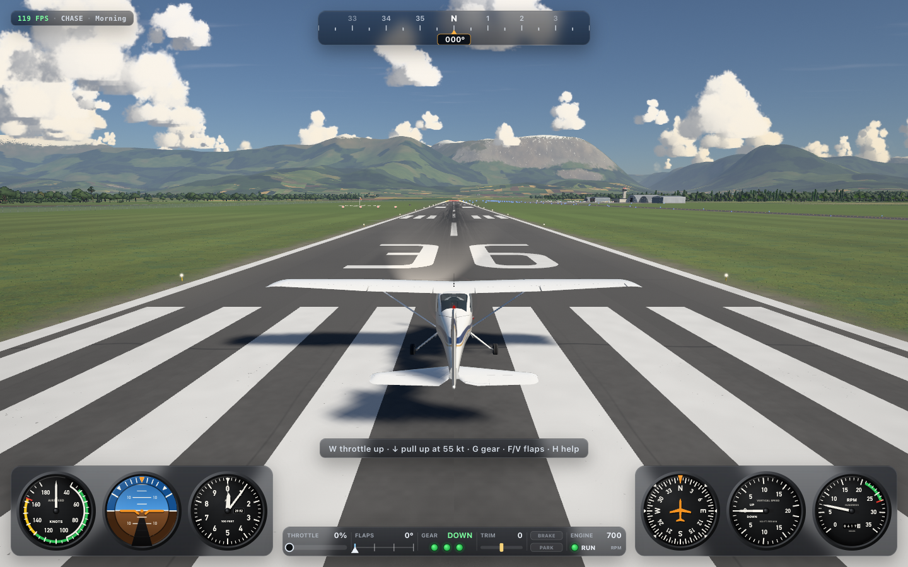
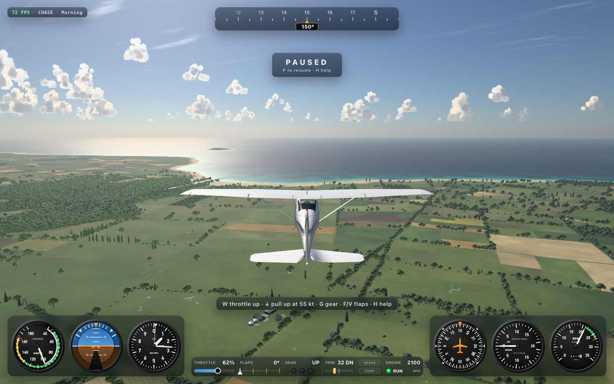

<!-- TODO(publish): replace <owner> with the GitHub account that hosts the repository, here and in package.json. -->

# Tater's Flight Sim

*The Tater Tots Flight Simulator.* Fly a **Cessna 172RG** or an **F-16C** in your web browser, over
a big procedural world of farmland, forests, rivers, a coastline, towns and snow-capped mountains.
The flight physics are real, so the aircraft can stall and spin. The sky is physically based, and
every texture, model and sound is generated in code. Nothing is downloaded at runtime, and the
only runtime dependency is [Three.js](https://threejs.org).

[](https://github.com/<owner>/taters-flight-sim/actions/workflows/ci.yml)
[](LICENSE)





## Features

- **Two aircraft.** Pick them from the dropdown at the top right. The **Cessna 172RG Cutlass** is a
  forgiving four-seat trainer with retractable gear. The **F-16C Fighting Falcon** is a supersonic
  fighter with an afterburner, a speed brake and a jet HUD. The fleet registry is built so that
  more aircraft can be added.
- **Real flight physics** at a fixed 120 steps per second, with lift, drag, thrust and moments.
  The aircraft stall and spin, and the Cessna has P-factor, ground effect, flaps, trim and wheel
  brakes. Landings are graded from *butter* to *hard*.
- **A procedural world** tens of kilometres across. It has Tater Field with its tower and hangars,
  the towns of Taterville and Port Chateau, roads, rivers, a bay, the sea and a mountain range
  whose peaks rise above 2,500 m. Cloud shadows move across the ground.
- **Crashes.** The aircraft breaks apart, with a fireball and smoke, and a crash camera follows
  the wreck. Press R to try again.
- **Cockpit, chase, fly-by and orbit cameras.** The cockpit has working steam gauges, and the jet
  gets a head-up display.
- **A HUD, a help overlay and a menu** (<kbd>Esc</kbd>) that lists every control and has a restart
  button.
- **Sound** made in the browser with WebAudio: engine, wind, stall horn, gear-warning horn, tyres
  and crash.
- **More than 1,400 automated tests**: unit, property-based fuzz, scripted whole flights and
  browser end-to-end tests.

## Quick start

You need **Node.js 22 or newer** (22.12+; any current LTS works), **git**, and a browser with
**WebGL2**. Chrome, Edge, Firefox and Safari 15+ all work.

```sh
git clone https://github.com/<owner>/taters-flight-sim.git
cd taters-flight-sim
npm install
npm start
```

Then open **http://127.0.0.1:8092** in your browser. A loading screen shows while the terrain
streams in. Press any key or click to start (this also turns the sound on). You start on
runway 36 with the engine idling.

**macOS.** Install Node from [nodejs.org](https://nodejs.org), with `brew install node`, or with
[nvm](https://github.com/nvm-sh/nvm) (`nvm install` reads the version from `.nvmrc`). Run the
commands above in Terminal.

**Linux.** Install Node with [nvm](https://github.com/nvm-sh/nvm) or your distribution's
NodeSource packages. Your distribution's default `nodejs` package may be too old, so check with
`node --version`. Run the commands above in a terminal.

**Windows.** Install Node from [nodejs.org](https://nodejs.org) (the LTS installer) or with
[nvm-windows](https://github.com/coreybutler/nvm-windows), and install
[Git for Windows](https://git-scm.com/download/win). Run the same commands in PowerShell, Windows
Terminal or Git Bash.

**About GPUs.** The game is tuned for 60 fps at 1440×900 on an Apple M2 Max. It lowers its render
resolution automatically when the frame rate drops. Any recent discrete GPU, or an integrated one
from the last few years, can fly it. Most of the load is the terrain, trees and clouds. If it runs
slowly:

- Use a smaller window.
- Add `?no=grass,vegetation` to the URL.
- On a laptop with two GPUs, make sure the browser uses the discrete one.
- Check `chrome://gpu` (or `about:support` in Firefox) to confirm hardware acceleration is on.

On a machine without a GPU, the browser draws WebGL on the CPU. The game still loads, but at less
than one frame per second, so it isn't playable.

If port 8092 is already in use, run `npx vite --port 5173` instead (any free port works). To
open the game from another device on your network, run `npx vite --host 0.0.0.0`.

## Flying

**Cessna, first flight.** Push the throttle up with <kbd>W</kbd> and let the speed build. At
about **55 knots**, hold <kbd>↓</kbd> to lift the nose to about 9°. Keep it there until about
70 knots, then relax. Raise the gear with <kbd>G</kbd> once you're climbing. At full power a real
172 needs a little **right rudder** (<kbd>D</kbd>) because of P-factor. The clean stall comes at
about 48 knots, and the STALL horn warns you first. If the gear is up and the power is back, the
**GEAR** horn sounds. Land at more than about 900 feet per minute and the gear collapses.

**F-16.** Push the throttle past about **90 %** to light the **afterburner**. Rotate at about
150 knots. <kbd>X</kbd> toggles the **speed brake**. The jet is fast and unforgiving, so keep an
eye on the angle of attack when you pull hard.

## Controls

| Action | Keys |
| --- | --- |
| Pitch: nose down / nose up | <kbd>↑</kbd> / <kbd>↓</kbd> |
| Roll left / right | <kbd>←</kbd> / <kbd>→</kbd> |
| Rudder left / right (and nosewheel steering) | <kbd>A</kbd> / <kbd>D</kbd> |
| Throttle up (past ~90 % lights the F-16 afterburner) | <kbd>W</kbd>, <kbd>Page Up</kbd>, <kbd>=</kbd>, <kbd>Numpad +</kbd> |
| Throttle down | <kbd>S</kbd>, <kbd>Page Down</kbd>, <kbd>-</kbd>, <kbd>Numpad -</kbd> |
| Flaps down / up, one notch at a time (0-10-20-30°) | <kbd>F</kbd> / <kbd>V</kbd> |
| Landing gear up / down | <kbd>G</kbd> |
| Wheel brakes (hold) / parking brake | <kbd>Space</kbd> / <kbd>B</kbd> |
| Speed brake (F-16) | <kbd>X</kbd> |
| Elevator trim: nose down / nose up | <kbd>[</kbd> / <kbd>]</kbd> |
| Engine start / stop | <kbd>E</kbd> |
| Landing light | <kbd>L</kbd> |
| Next camera | <kbd>C</kbd> |
| Cockpit / chase / fly-by / orbit camera | <kbd>1</kbd> / <kbd>2</kbd> / <kbd>3</kbd> / <kbd>4</kbd> |
| Look around (cockpit) or orbit (outside cameras) | drag with the mouse; the wheel zooms |
| Reset on the runway / start on final approach | <kbd>R</kbd> / <kbd>Shift</kbd>+<kbd>R</kbd> |
| Pause | <kbd>P</kbd> |
| Menu: every control, restart, pause | <kbd>Esc</kbd> |
| Help overlay | <kbd>H</kbd> |
| Hide / show the HUD | <kbd>I</kbd> |
| Mouse yoke on / off | <kbd>Y</kbd> |
| Mute | <kbd>M</kbd> |
| Next time of day | <kbd>N</kbd> |

Every binding lives in `src/config.ts` under `controls.keys`. A test checks that this table lists
all of them.

## URL options

Add these to the address, for example `http://127.0.0.1:8092/?aircraft=f16&cam=cockpit`.

| Option | What it does |
| --- | --- |
| `aircraft=c172rg` or `aircraft=f16` | Choose the aircraft |
| `spawn=x,z,aglFt,headingDeg,speedKt` | Start airborne anywhere. `x` is metres east and `z` metres south of the runway centre |
| `cam=cockpit`, `chase`, `external` or `orbit` | Starting camera |
| `tod=0` to `3` | Time of day: morning, midday, golden hour, dawn |
| `pause=1` | Start paused |
| `veil=0` | Skip the loading screen |
| `no=terrain,water,airport,roads,towns,vegetation,grass,fx,audio,hud` | Switch systems off, for debugging or speed |
| `clouds=volumetric`, `billboard` or `off` | Cloud renderer |
| `cloudshadows=0` | No cloud shadows on the ground |

In the browser console, `window.sim` shows the live state: airspeed, altitude, heading, pitch,
roll, throttle, gear, flaps, state, fps, and more. It also has the actions `reset()`,
`resetApproach()`, `selectAircraft(id)`, `teleport({x, z, aglFt, headingDeg, speedKt})`,
`setCamera(mode)`, `setTimeOfDay(i)`, `pause()`, `resume()` and `debug()`.

## Tests

```sh
npx playwright install chromium   # once: the browser for the end-to-end tests
npm test                          # every test: unit, fuzz, scripted flights, browser
npm run typecheck                 # TypeScript
npm run check                     # typecheck + test + build
```

On Linux, `npx playwright install --with-deps chromium` also installs the system libraries the
browser needs. With a GPU, the whole suite takes about 30 seconds. On a machine without a GPU
(like a CI runner), the browser tests draw on the CPU and take 15 minutes or more instead. They
stretch their waits automatically.

The browser tests never use your everyday Google Chrome. They use:

1. the browser named in `TEST_BROWSER` (a path to a Chromium binary), if set;
2. otherwise, on macOS, the newest *Google Chrome for Testing* that Playwright has installed (it
   renders on the real GPU);
3. otherwise, Playwright's own Chromium.

`TEST_SOFTWARE_GL=1` forces CPU rendering, which is how you reproduce a CI run locally. There's
more in [docs/TESTING.md](docs/TESTING.md), including running one layer and replaying a fuzz
failure.

## Build and deploy

```sh
npm run build      # production build into dist/
npm run preview    # serve dist/ on http://127.0.0.1:8092
```

`dist/` is a plain static site: HTML, JavaScript and web workers, with no server code. Any static
host can serve it, including GitHub Pages, Netlify, Cloudflare Pages, S3 or nginx.

- **At the root of a domain** (`https://example.com/`), use `npm run build`.
- **Under a sub-path** (`https://<owner>.github.io/taters-flight-sim/`), pass Vite's `--base`:
  `npm run build -- --base=/taters-flight-sim/`. You can also use `npm run build -- --base=./`,
  which gives relative URLs and works from any folder.
- **GitHub Pages.** In the repository settings, set *Pages → Source* to **GitHub Actions**. Then
  run the **Deploy to GitHub Pages** workflow from the *Actions* tab. It builds with the right
  `--base` for the repository name.
- **Netlify and similar hosts.** Set the build command to `npm run build` and the publish
  directory to `dist`.

## Project layout

```
src/
  config.ts      every tunable number: physics, controls, cameras, world, rendering, audio, HUD
  types.ts       shared contracts and frame conventions (+X east, +Y up, +Z south)
  fleet/         the aircraft registry (add an aircraft here)
  physics/       pure, deterministic flight model: step(state, controls, dt, env)
  input/         keyboard, mouse and gamepad to smoothed controls
  camera/        cockpit, chase, fly-by and orbit camera rig
  game/          main loop, window.sim, and systems/ (one plug-in per world feature)
  world/         terrain, water, airport, roads, towns, trees, grass (pure data + renderers)
  render/        renderer, sky, atmosphere, clouds, tone mapping
  aircraft/      procedural aircraft models, cockpit and animation
  ui/            instruments, HUD, menu, help
  audio/  fx/    WebAudio synthesis; particles
tests/           mirrors src/; plus fuzz/, functional/, e2e/, repo/ and support/
scripts/         screenshot tool, scripted QA pilot, repo map generator
qa/screenshots/  photos taken while play-testing
```

To see how it all fits together, read [ARCHITECTURE.md](ARCHITECTURE.md). For every file and
folder, see [REPO_MAP.md](REPO_MAP.md). The build history is in [RECORD.md](RECORD.md).

## Contributing

Bug reports, ideas and pull requests are welcome. [CONTRIBUTING.md](CONTRIBUTING.md) explains how
to set up, the test-first workflow and what a good pull request looks like. Please follow the
[Code of Conduct](CODE_OF_CONDUCT.md). To report a security problem, see
[SECURITY.md](SECURITY.md).

## License

[MIT](LICENSE) © 2026 Jared Tate.

## Credits

Built with [Three.js](https://threejs.org) (WebGL2 rendering), [TypeScript](https://www.typescriptlang.org),
[Vite](https://vite.dev) (dev server and build), [Vitest](https://vitest.dev) (test runner),
[fast-check](https://fast-check.dev) (property-based tests), [Playwright](https://playwright.dev)
(browser automation) and [happy-dom](https://github.com/capricorn86/happy-dom) (DOM for unit
tests). Aircraft data comes from public Cessna 172RG and F-16C figures. Every model, texture and
sound in the game is generated procedurally in this repository.
